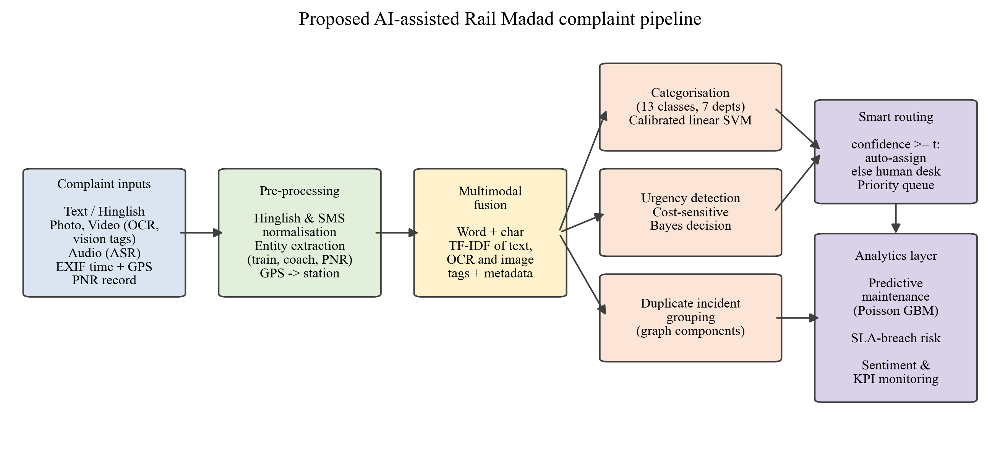

# AI-Powered Complaint Management for Rail Madad

**Smart India Hackathon 2024 – Problem Statement SIH1711 (Ministry of Railways)**
Course project for *23CS2024 – Data Science Ecosystem*.

The project builds a data-science pipeline that turns raw, multimodal passenger complaints (text, Hinglish, photos via OCR and image tags, voice via speech-to-text, EXIF/GPS metadata) into **categorised, prioritised, de-duplicated and routed tickets**. It also turns the complaint stream into **predictive-maintenance** and **service-quality** insights. There is no UI; the focus is on the data-science methods.



## Key results (6-month held-out test set)

| Module | Method | Result |
|---|---|---|
| Categorisation (13 classes) | Word + char TF-IDF, multimodal fusion, calibrated linear SVM | **95.1% accuracy**, 0.934 macro-F1, 95.9% correct department |
| Smart routing | Confidence threshold (selective classification) | 97.6% auto-routed at 97.0% accuracy; 2.4% to human desk |
| Multimodal value | Ablation: text → +OCR → +vision tags | Photo/video accuracy 93.7% → 96.5% |
| Urgency (4 levels) | Logistic regression + minimum-expected-cost decision | Critical recall 94.9%, under-triage 1.6% (vs 6.4% arg-max) |
| Prioritisation | Discrete-event queue simulation | Mean wait for critical complaints 535 → 32 min |
| Extraction | Regex on text + OCR; haversine on GPS | Train-number recovery 41% → 51% with OCR; station from GPS 99.8% |
| Duplicate incidents | Same train + 6 h + category + coach/cosine, graph components | Pairwise F1 0.97; 18% fewer tickets |
| Predictive maintenance | Poisson gradient boosting on weekly counts | Poisson deviance −65% vs naive; precision@8 for deteriorating trains 50% vs 13% random |
| Feedback & SLA | TF-IDF sentiment model; SLA-breach classifier | Sentiment acc. 80.8%; breach ROC-AUC 0.73 |

## Dataset

Real Rail Madad data is not public, so `src/generate_dataset.py` simulates **25,133 complaints** (Jan 2025 – Sep 2026, 60 trains, 13 categories, 7 departments, 4 severities). The simulation is process-driven:

- each train has a latent condition per category (AR(1)), and 8 trains deteriorate over time; older rakes fail more often
- seasonality: summer AC/water failures, monsoon leakage, winter fog delays, festival crowding
- noisy language: 18% Hinglish, typos and SMS spellings, mixed complaints, vague complaints, 3% label noise
- multimodal fields: OCR text, imperfect vision tags, ASR transcripts, EXIF capture lag, GPS
- multi-passenger incidents, log-normal resolution times, SLA breaches, feedback text and ratings

The generated CSV is included in `data/raw/`, and running the generator reproduces it exactly (seeded).

## Project structure

```
├── run_all.py                  # runs the complete pipeline (~2 min)
├── requirements.txt
├── src/
│   ├── generate_dataset.py     # synthetic multimodal complaint simulator
│   ├── common.py               # paths, plot style, Hinglish/SMS normalisation, fusion
│   ├── eda.py                  # exploratory analysis
│   ├── categorize.py           # model comparison, ablation, confusion matrix, routing
│   ├── urgency.py              # cost-sensitive severity + queue simulation
│   ├── extraction_dedup.py     # entity extraction, GPS, duplicate grouping
│   ├── predictive_maintenance.py
│   ├── sentiment_sla.py        # sentiment, SLA-breach risk, KPI monitoring
│   └── architecture.py         # pipeline diagram
├── data/raw/                   # rail_madad_complaints.csv, train_master.csv
├── data/processed/             # test-set predictions
├── results/                    # all metric tables (CSV/JSON) + pipeline_log.txt
├── figures/                    # 300-dpi figures
└── report/                     # report (DOCX/PDF) and its generator
```

## How to run

```bash
pip install -r requirements.txt
python run_all.py
python report/build_report.py   # optional: rebuild the report
```

## Limitations

The data is synthetic, so absolute scores, especially duplicate grouping, would be lower on real records. Vision tags and ASR transcripts are simulated model outputs. See Section 9 of the report.
